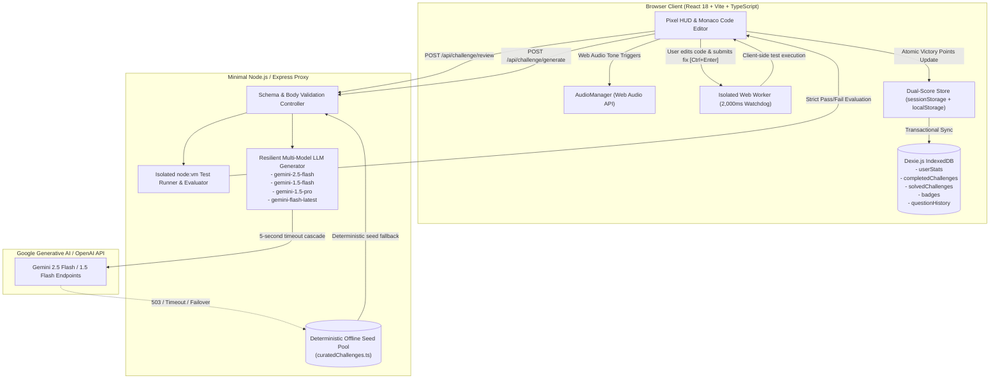

# 🎮 BugBounty Arena: Zero-Database Client-Side Vulnerability & Algorithmic Debugging Sandbox

[](LICENSE)
[](client/)
[](server/)
[](client/src/lib/db.ts)

---

## 🚀 Overview

**BugBounty Arena** is an arcade-style, client-side vulnerability remediation and algorithmic debugging sandbox. Players analyze, inspect, and patch security flaws, concurrency traps, and subtle DSA edge cases across 8+ programming stacks under time-pressured cryogenic countdown conditions.

Featuring an **ICE MATRIX cyberpunk aesthetic**, dual-tier scoring engine, Web Audio API procedural sound synthesis, isolated sandboxed execution workers, and a **zero-database client-side architecture** backed by Dexie.js IndexedDB and `sessionStorage`.

---

## 🏗️ Architecture & Data Flow Diagram



---

## ⚡ Key Technical Innovations

### 1. 100% Client-Side Privacy & Zero-Database Architecture
- **Strict Client-Side Privacy**: All scores, streaks, unlocked achievement badges, and solved bounty archives remain strictly client-confined. The app operates with zero mandatory cloud databases, external tracking cookies, or server-side player registries.
- **No Stateful Server Database**: The backend operates strictly stateless, exposing zero database attack surface.
- **Client Ledger via Dexie.js (IndexedDB)**: Career scores, streaks, unlocked achievement badges, and solved challenge milestones persist across hard refreshes (`Ctrl+F5`) in browser-local IndexedDB tables:
  - `userStats`: Career score, consecutive daily streaks, and last timestamp.
  - `completedChallenges`: Verified completion records with cryptographic fingerprints.
  - `solvedChallenges`: Archive of solved code submissions.
  - `badges`: Dynamic achievement unlocks.
  - `questionHistory`: Anti-repetition sliding window context (last 50 challenges).
- **Dual-Score Synchronization**: `sessionScore` is isolated to the active tab via `sessionStorage`, while `lifetimeScore` hydrates synchronously from local cache into Zustand state without flashing blank/zero states on hard reload.

### 2. Resilient Multi-Model LLM Cascade & Offline Fallback Pool
- **Stable Cascade Matrix**: Sequentially cascades across `["gemini-2.5-flash", "gemini-1.5-flash", "gemini-1.5-pro", "gemini-flash-latest"]`.
- **Exponential Backoff with Jitter**: Up to 2 retries per model candidate with randomized jitter delays (`500ms * 2^attempt + jitter`).
- **5-Second Timeout Protection**: Calls to upstream LLMs are constrained by a strict 5,000ms threshold (`Promise.race`).
- **Deterministic Offline Seed Pool (`server/src/fixtures/curatedChallenges.ts`)**: If all cloud endpoints fail, timeout, or experience 503 traffic surges, the server automatically serves vetted deterministic challenge seeds tagged `{ source: "curated_fallback" }` with zero 500 crashes.

### 3. Strict Pass/Fail Evaluation Pipeline
- **Isolated Sandbox Execution**: Evaluated in an isolated environment with a hard 2,000ms execution timeout to kill accidental infinite loops safely without UI thread lockup.
- **Hidden Edge-Case Verification**: Challenge test cases include both visible verification tests and at least one hidden edge case (`hidden: true`).
- **Leak-Proof Diagnostics**: Visible test failures render exact diagnostics (`Failed Test X/Y`, `Input: [...]`, `Expected: [...]`, `Actual: [...]`). Hidden test failures report `Failed on hidden edge case verification.` without leaking internal assertion code.

### 4. Comprehensive Multi-Language Taxonomy
Supports complete DSA and practical vulnerability topics across 9 language stacks:
- **C++**: Vectors & Pointer Arithmetic, Two Pointers, Trees, std::priority_queue, Graphs, DP.
- **C**: Pointer Indirection, Memory Allocation (malloc/free), Buffer Overflows, Struct Stacks/Queues.
- **Python**: List Slicing, Two Pointers, Recursion Depth, Heapq, Graph BFS/DFS, LRU Cache.
- **JavaScript**: Array Methods, Object Hashing, Sliding Window, Deep Recursion, ES6 Classes.
- **TypeScript**: Generics, Strict Null Pointers, Readonly Trees, Index Signatures.
- **Java**: ArrayList Indexing, LinkedList Null Pointers, Deque, PriorityQueue, Dynamic Programming.
- **SQL**: Window Functions (ROW_NUMBER, RANK, DENSE_RANK), Recursive CTEs, Correlated Subqueries, JOINs.
- **Go**: Slice Backing Array Mutations, Goroutine Races, Nil Interface Traps.
- **Rust**: Unsigned Subtraction Underflows, Interior Mutability RefCell Borrows, Lifetimes.

---

## 🛠️ Local Development & Setup

### Prerequisites
- Node.js >= 18.0.0
- npm >= 9.0.0

### Installation

```bash
# Clone repository
git clone https://github.com/your-repo/BugBounty.git
cd BugBounty

# Install root, client, and server dependencies
npm run install:all
```

### Environment Configuration

Create `server/.env` with your API credentials (optional — offline fallback pool operates seamlessly without any API key):

```env
PORT=3001
ALLOWED_ORIGINS=http://localhost:5173,http://localhost:4173
GEMINI_API_KEY=your_gemini_api_key_here
GEMINI_MODEL=gemini-2.5-flash
```

### Running Locally

```bash
# Start both client (Vite on :5173) and server (Express on :3001) concurrently
npm run dev

# Or run client and server independently:
npm run dev:client
npm run dev:server
```

### Running Test Suites

```bash
# Run client unit & regression test suite (Vitest)
npm --prefix client test

# Run build typechecks
npm --prefix client run build
npm --prefix server run build
```
---

## 📄 License
This project is licensed under the MIT License — see the [LICENSE](LICENSE) file for details.
