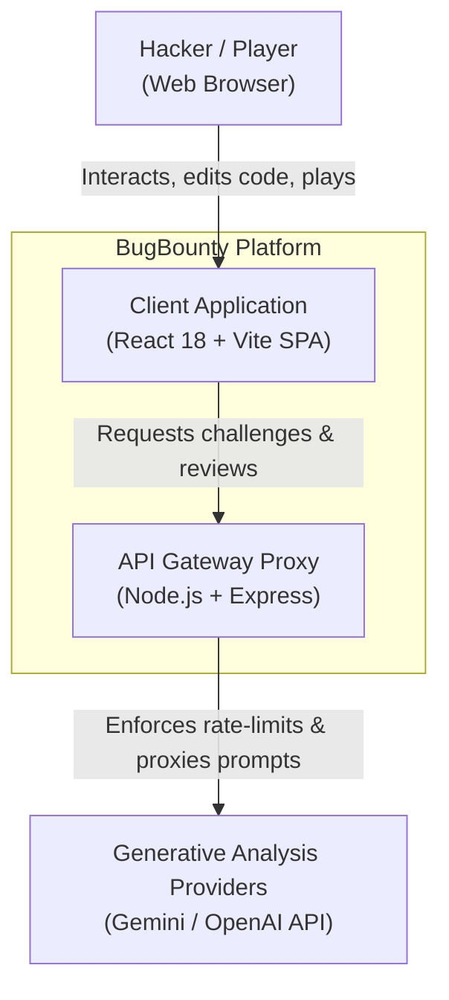
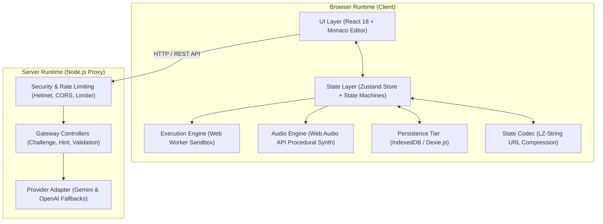
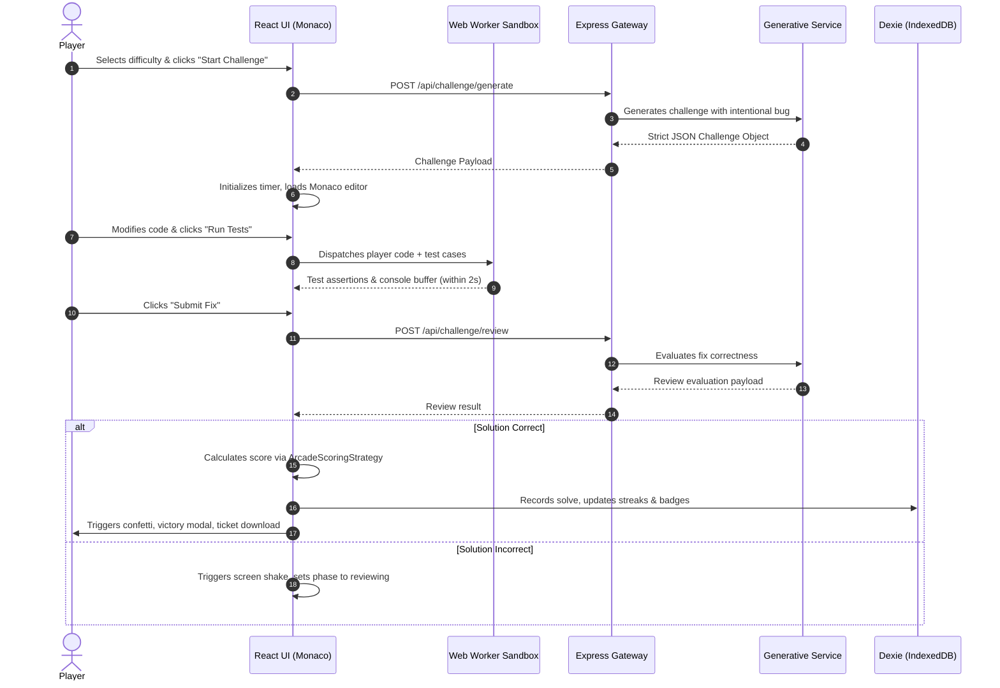

# System Architecture Document — BugBounty

> **Version:** 1.0.0  
> **Status:** Production Standard  
> **Classification:** Technical Architecture Specification  

---

## 1. Executive Summary & Architectural Principles

**BugBounty** is an arcade-inspired web application designed for interactive software vulnerability remediation and code debugging. The architecture prioritizes client-side independence, sub-second latency, deterministic state transitions, and zero mandatory backend database infrastructure.

### Core Architectural Tenets

1. **Client-Centric Execution & Zero Database Footprint**  
   All code execution, evaluation, audio synthesis, and career progression persist within the user's browser. The application utilizes client-side storage technologies (IndexedDB via Dexie.js and localStorage) with no server-side user database requirement.
2. **Sandboxed Zero-Trust Code Execution**  
   Player code runs in dedicated Web Worker threads wrapped with strict watchdog timers (2,000 ms), isolating untrusted code execution from the browser's main UI thread to prevent freezing, event loop starvation, or DOM compromise.
3. **Deterministic Finite State Machines (FSM)**  
   Critical user flows—such as hint unlocks, challenge forfeitures, and submission transitions—are governed by mathematical state machines (`GameActionMachine` and `HintStateMachine`) that prevent illegal transitions and race conditions.
4. **Strategy Pattern Scoring Engine**  
   Scoring logic adheres to the Single Responsibility Principle (SRP) via an interchangeable Strategy Pattern (`ScoreCalculator` and `ArcadeScoringStrategy`), calculating itemized point breakdowns factoring speed, hint deductions, streak multipliers, and first-attempt bonuses.
5. **Hierarchical Fault Containment (Error Boundaries)**  
   Visual components are wrapped with domain-specific React `ErrorBoundary` wrappers. A rendering failure in the Monaco Editor or Scoreboard is isolated locally, allowing the rest of the arena to remain interactive.
6. **Serverless State Sharing via LZ-String**  
   Challenges can be distributed via compressed URL hash fragments (`#challenge=...`), enabling peer-to-peer challenge sharing without server persistence or external link shorteners.
7. **Stateless Gateway Proxy**  
   The Node.js Express service acts strictly as a lightweight (~100 LOC) security gateway, shielding API credentials, enforcing IP rate limits, and proxying requests to generative analysis services.

---

## 2. System Context & Container Architecture

### 2.1 C4 System Context Diagram



### 2.2 Container & Subsystem Topology



---

## 3. Client Architecture

### 3.1 Presentation & Component Layer
- **Framework:** React 18 with Vite 8.
- **Styling:** Tailwind CSS v4 paired with a retro-arcade cyberpunk design system (`Press Start 2P`, `JetBrains Mono`, custom CSS variables for neon cyan, magenta, and amber glows).
- **Editor:** Monaco Editor integration supporting syntax highlighting, bracket pair colorization, line decorations, keyboard shortcuts (`Ctrl/Cmd + Enter`), and a side-by-side Diff view comparing original buggy code with player modifications.
- **Visual Feedback:** Procedural SVG radial countdown rings, confetti bursts (`canvas-confetti`), and animated screen shakes upon incorrect submissions.

### 3.2 State Management & Action Governance
- **Store Architecture:** Powered by Zustand with `subscribeWithSelector` middleware (`useGameStore.ts`).
- **Finite State Machine Guards:**
  - `GameActionMachine`: Prevents illegal actions (e.g., forfeiting while a submission is in flight, running empty code, starting challenges during active rounds).
  - `HintStateMachine`: Controls 3-tier progressive hint revelation (`HIDDEN` -> `CONFIRMATION` -> `REVEALED` -> `EXHAUSTED`). Logs an immutable audit trail (`HintAuditRecord`) and applies a compound 15% score deduction per tier.
- **Game Phases:**
  ```
  [idle] ──(Start)──> [loading] ──(Loaded)──> [playing]
                         │                       │
                         │                   (Submit)
                         │                       v
                         │                  [reviewing]
                         │                   ├──(Correct)──> [victory]
                         │                   └──(Incorrect)─> [playing]
                         │
                         └──────(Forfeit / Timeout)────────> [defeat]
  ```

### 3.3 Sandboxed Execution Engine
- Untrusted JavaScript code executes inside an isolated Web Worker instantiated via an inline Blob URL (`useCodeRunner.ts` / `codeRunner.worker.ts`).
- **Dual Execution Modes:**
  1. *Free Run Mode:* Executes top-level script, redirects and formats `console.log` statements into an in-memory buffer, and reports elapsed execution time.
  2. *Test Suite Mode:* Extracts the exported `solution` function, executes parameterized test case tuples, and validates output parity via deep JSON equality assertions.
- **Watchdog Protection:** A 2,000 ms host watchdog timer automatically terminates any worker exceeding the execution threshold, catching infinite loops (`while(true)`) and preventing browser thread starvation.

### 3.4 Error Handling & Fault Isolation
- **Domain Error Hierarchy (`AppErrors.ts`):**  
  Strongly typed subclasses extending `AppError`:
  - `GameActionError`: Invalid phase transitions or state machine rejections.
  - `CodeExecutionError`: Worker crashes, syntax exceptions, or watchdog timeouts.
  - `NetworkApiError`: API failures, HTTP 429 rate limit throttles, or service outages.
  - `StorageError`: IndexedDB quota exceptions or read/write failures.
  - `ChallengeValidationError`: Corrupted or malformed URL challenge hashes.
  - `HintExhaustedError`: Quota violations or post-timeout hint requests.
  - `AudioPlaybackError`: Web Audio API suspension or oscillator failures.
- **Subtree Containment (`ErrorBoundary.tsx`):**  
  Class-based React Error Boundaries wrap key subtrees:
  - `ArenaHeader`
  - `Scoreboard`
  - `ChallengeOverview`
  - `ArcadeHUD`
  - `CodeEditorWorkspace`
  - `ActionControls`
  - `ModalSubsystem`  
  When an uncaught rendering error occurs, only the affected card displays a localized alert card with a "Retry Subtree" button; the rest of the application remains operational.

### 3.5 Scoring Engine & Calendar Streaks
- **Scoring Formula (`ScoreCalculator.ts`):**
  $$\text{TimeBonus} = \lfloor \text{BasePoints} \times 0.5 \times \text{TimeRatio} \rfloor$$
  $$\text{Subtotal} = \lfloor (\text{BasePoints} + \text{TimeBonus}) \times (1 - \min(0.80, \text{HintsUsed} \times 0.15)) \rfloor$$
  $$\text{FinalScore} = \max(10, \lfloor \text{Subtotal} \times \text{StreakMultiplier} \rfloor + \text{FirstAttemptBonus})$$
- **Calendar-Day Streak Algorithm (`StreakManager.ts`):**  
  Timestamps are normalized to local midnight boundaries:
  - $\Delta\text{days} = 0$: Solved on the same day; record timestamp updates without incrementing streak count.
  - $\Delta\text{days} = 1$: Solved on the consecutive day; streak increments by 1.
  - $\Delta\text{days} > 1$: Lapsed streak; resets active streak to 1 while preserving all-time record.

### 3.6 Offline Persistence Tier (`db.ts`)
- IndexedDB database (`BugBountyArenaDB`) configured via Dexie.js:
  - `solvedChallenges`: Archive of completed bounties with user code and elapsed time.
  - `profile`: Hacker callsign, career points, active streak, and badge achievements.
  - `highScores`: Personal local high score runs.
  - `runHistory`: Detailed execution attempts.
  - `badges`: Unlocked achievement milestones (`NOVICE_HUNTER`, `BOUNTY_ADEPT`, `CODE_LEGEND`, `STREAK_WARRIOR`, `ZERO_DAY_MASTER`).

---

## 4. Backend Gateway Architecture

### 4.1 Responsibilities
The Node.js Express server (`server/src`) is designed with zero business logic, serving exclusively as a secure API gateway:
- **Credential Protection:** Keeps third-party API keys out of client bundles.
- **Traffic Throttling:** Protects against automated abuse using `express-rate-limit`.
- **Mathematical Integrity Validation:** Provides server-side mirrors of scoring, streak, and hint logic for verification.

### 4.2 Security Middleware Pipeline
```
[Client Request]
       │
       ▼
 [Helmet Security Headers]
       │
       ▼
 [CORS Allowlist Validation]
       │
       ▼
 [JSON Body Parser (100kb Limit)]
       │
       ▼
 [Tiered Rate Limiters]
  ├── General Endpoints (150 requests / 15 min)
  └── Generative Endpoints (30 requests / 15 min)
       │
       ▼
 [Route Handlers / Controllers]
       │
       ▼
 [Global Error Handler Middleware]
```

### 4.3 Generative Challenge Service & Fallback Strategy (`llm.service.ts`)
- **Multi-Provider Adapter:** Supports Google Gemini/Gemma (`gemini-3.6-flash`, `gemini-3.1-flash-lite`, `gemini-2.5-flash`, `gemini-2.5-flash-lite`, `gemma-4`) and OpenAI (`gpt-4o-mini`) using standardized system instructions and JSON response constraints.
- **Parsing Resilience:** Sanitizes markdown code fences (````json ... ````) and applies fallback regular expression extractors when direct JSON parsing encounters trailing delimiters.
- **Curated Offline Fallbacks:** If external API keys are missing, exhausted, or offline, the service provides curated debugging challenges across Easy, Medium, and Hard tiers, ensuring full offline functionality.

---

## 5. Data Flow Specification

### Challenge Lifecycle Flow



---

## 6. Threat Assessment & Security Model

| Threat Vector | Mitigation Strategy | Component |
| :--- | :--- | :--- |
| **Malicious Code Execution** | Code is never evaluated on the server or in the main DOM thread. Code executes exclusively in an ephemeral, sandboxed Web Worker Blob URL. | `useCodeRunner.ts` / `codeRunner.worker.ts` |
| **Denial of Service (Infinite Loops)** | Worker execution is bounded by a 2,000 ms host watchdog timer that terminates non-responsive workers. | `useCodeRunner.ts` |
| **Prototype Pollution** | Challenge schemas guard against prototype tampering; server fallback challenges validate key boundaries; code runner uses isolated global scopes. | `validation.controller.ts` |
| **API Credential Theft** | API keys are stored in backend environment variables (`.env`) and never exposed to the client bundle. | `server/src/services/llm.service.ts` |
| **API Abuse & Quota Exhaustion** | IP-based sliding window rate limiters restrict generative endpoints to 30 requests per 15 minutes. | `server/src/middleware/rateLimiter.ts` |
| **Cross-Origin Exploitation** | Strict CORS middleware checks origin against allowlisted domains. Helmet sets standard security headers. | `server/src/app.ts` |
